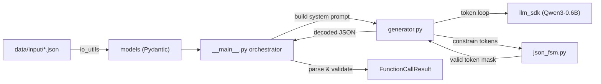

# Call Me Maybe — LLM Function-Calling Implementation Plan

## Problem Statement

Build a **local LLM-powered function-calling system** that:

1. Reads a catalog of function definitions (name, description, parameters, return type) from JSON
2. Reads natural-language prompts (e.g. *"What is the sum of 2 and 3?"*)
3. Uses the **Qwen3-0.6B** model (via the provided `llm_sdk`) to generate a **structured JSON function call** — selecting the right function and extracting the right parameter values
4. Uses a **JSON finite-state machine (FSM)** to constrain the LLM's token-by-token output so the result is always valid, parseable JSON matching the expected schema
5. Outputs `FunctionCallResult` objects (prompt, function name, parameters)

The project skeleton already exists with stub files. The `llm_sdk` package is already implemented and provides `Small_LLM_Model` with: `encode()`, `decode()`, `get_logits_from_input_ids()`, and vocab/tokenizer file accessors.

---

## Architecture Overview



> [!IMPORTANT]
> The `explain.pdf` is a **survey of the dataores-marketbrains** repo — a completely separate Next.js project. It is **not** the specification for this `Call_Me_Maybe` project. The Call_Me_Maybe project is a **Python LLM function-calling exercise** as evidenced by the existing skeleton code, stub files, data inputs, models, and llm_sdk. The plan below is built from the **actual codebase** — not the PDF survey content (which appears to be contextual background for a different repo the user works on).

---

## Existing Code Inventory

| File | Status | Purpose |
|------|--------|---------|
| [llm_sdk/\_\_init\_\_.py](file:///c:/Users/faris/Desktop/42/Call_Me_Maybe/llm_sdk/llm_sdk/__init__.py) | ✅ Complete | `Small_LLM_Model` — load Qwen3-0.6B, encode/decode, get_logits |
| [src/models.py](file:///c:/Users/faris/Desktop/42/Call_Me_Maybe/src/models.py) | ✅ Complete | `ParamType`, `ParameterSpec`, `FunctionDefinition`, `PromptEntry`, `FunctionCallResult` |
| [src/io_utils.py](file:///c:/Users/faris/Desktop/42/Call_Me_Maybe/src/io_utils.py) | ⚠️ Has bugs | Reads function defs — but has critical bugs (see below) |
| [src/json_fsm.py](file:///c:/Users/faris/Desktop/42/Call_Me_Maybe/src/json_fsm.py) | 🔴 Stub | Comment only: `# state machine - FSM - pure logic, no LLM` |
| [src/generator.py](file:///c:/Users/faris/Desktop/42/Call_Me_Maybe/src/generator.py) | 🔴 Stub | Comment only: `# the actual token-by-token loop using llm_sdk` |
| [src/\_\_main\_\_.py](file:///c:/Users/faris/Desktop/42/Call_Me_Maybe/src/__main__.py) | 🔴 Stub | Empty `main()` |
| [data/input/functions_definition.json](file:///c:/Users/faris/Desktop/42/Call_Me_Maybe/data/input/functions_definition.json) | ✅ Complete | 5 functions: add, greet, reverse, sqrt, regex_substitute |
| [data/input/function_calling_tests.json](file:///c:/Users/faris/Desktop/42/Call_Me_Maybe/data/input/function_calling_tests.json) | ✅ Complete | 11 test prompts |
| [tests/tester.py](file:///c:/Users/faris/Desktop/42/Call_Me_Maybe/tests/tester.py) | ⚠️ Commented out | Manual validation code, all commented |

---

## Proposed Changes

### Component 1: `io_utils.py` — Fix Bugs & Add Prompt Loader

#### [MODIFY] [io_utils.py](file:///c:/Users/faris/Desktop/42/Call_Me_Maybe/src/io_utils.py)

**Current bugs:**
1. **Line 10**: `json.loads(f)` — passes a *file object* not a string. Should be `json.load(f)` (no `s`)
2. **Line 12**: `data.strip()` — called *after* JSON parse, where `data` is already a Python object (list/dict), not a string. The emptiness check should happen on the raw file content or on the parsed list
3. **Missing return**: After validation, the function never actually returns the parsed `FunctionDefinition` list
4. **Missing function**: `read_func_definition` exists but there's no `read_prompts` function for loading `PromptEntry` objects

**Pseudo-code for the fixed module:**

```python
# io_utils.py — load/save JSON with try/except, clear error messages
import json
from pathlib import Path
from pydantic import ValidationError
from models import FunctionDefinition, PromptEntry

def read_func_definition(file_path: str) -> list[FunctionDefinition]:
    """
    Read a JSON file containing a list of function definitions.
    Returns a list of validated FunctionDefinition objects.
    """
    try:
        with open(file_path, "r") as f:
            raw = f.read()                        # read raw string first

        if not raw.strip():                       # empty-file check BEFORE parse
            print(f"Error: file is empty: {file_path}")
            return []

        data = json.loads(raw)                    # parse the string

        if not isinstance(data, list):
            print(f"Error: expected a JSON list, got {type(data).__name__}")
            return []

        # Validate each entry through Pydantic
        result: list[FunctionDefinition] = []
        for i, entry in enumerate(data):
            result.append(FunctionDefinition.model_validate(entry))
        return result                             # <-- actually return!

    except FileNotFoundError:
        print(f"Error: file not found: {file_path}")
        return []
    except json.JSONDecodeError as e:
        print(f"Error: invalid JSON in {file_path}: {e}")
        return []
    except ValidationError as e:
        print(f"Error: invalid FunctionDefinition data: {e}")
        return []
    except OSError as e:
        print(f"Error: could not read file {file_path}: {e}")
        return []


def read_prompts(file_path: str) -> list[PromptEntry]:
    """
    Read a JSON file containing a list of prompt entries.
    Mirrors the structure of read_func_definition but for PromptEntry.
    """
    try:
        with open(file_path, "r") as f:
            raw = f.read()

        if not raw.strip():
            print(f"Error: file is empty: {file_path}")
            return []

        data = json.loads(raw)

        if not isinstance(data, list):
            print(f"Error: expected a JSON list, got {type(data).__name__}")
            return []

        return [PromptEntry.model_validate(entry) for entry in data]

    except FileNotFoundError:
        print(f"Error: file not found: {file_path}")
        return []
    except json.JSONDecodeError as e:
        print(f"Error: invalid JSON in {file_path}: {e}")
        return []
    except ValidationError as e:
        print(f"Error: invalid PromptEntry data: {e}")
        return []
    except OSError as e:
        print(f"Error: could not read file {file_path}: {e}")
        return []
```

**Key changes:**
- Fix `json.loads(f)` → read raw string first, then `json.loads(raw)`
- Fix `.strip()` check on raw string *before* parse
- Add the missing `return result`
- Add `read_prompts()` function for loading test prompts

---

### Component 2: `json_fsm.py` — JSON Finite-State Machine

#### [MODIFY] [json_fsm.py](file:///c:/Users/faris/Desktop/42/Call_Me_Maybe/src/json_fsm.py)

This is the core constrained-decoding engine. It tracks the structural state of the JSON being generated token-by-token and tells the generator which tokens are **legal** at each step.

**Design rationale**: A small 0.6B model will frequently produce malformed JSON (missing quotes, wrong brackets, trailing commas). The FSM acts as a **guardrail** — after each generated token, it updates its state and computes a set of allowed next tokens. The generator masks all disallowed tokens to `-inf` before sampling, so every generated sequence is structurally valid JSON.

**FSM States:**

```
EXPECT_OPEN_BRACE       → only `{` is allowed
EXPECT_KEY_OR_CLOSE     → `"` (start a key) or `}` (end object)
IN_KEY                  → any string characters until closing `"`
EXPECT_COLON            → only `:` is allowed
EXPECT_VALUE            → `"` (string), digit/`-` (number), `{` (object), `[` (array), `t`/`f`/`n` (bool/null)
IN_STRING_VALUE         → any string characters until closing `"`
IN_NUMBER_VALUE         → digits, `.`, `e`, `E`, `+`, `-`
EXPECT_COMMA_OR_CLOSE   → `,` (more entries) or `}` / `]` (close container)
DONE                    → only EOS is allowed
```

**Pseudo-code:**

```python
# json_fsm.py — state machine - FSM - pure logic, no LLM
from enum import Enum, auto

class JsonState(Enum):
    EXPECT_OPEN_BRACE = auto()
    EXPECT_KEY_OR_CLOSE = auto()
    IN_KEY = auto()
    EXPECT_COLON = auto()
    EXPECT_VALUE = auto()
    IN_STRING_VALUE = auto()
    IN_NUMBER_VALUE = auto()
    EXPECT_COMMA_OR_CLOSE = auto()
    DONE = auto()

class JsonFSM:
    """
    Tracks JSON generation state and provides token filtering.
    
    This FSM does NOT touch the LLM or tokenizer. It works purely
    on decoded character output to decide which characters are valid next.
    The generator translates these character-level constraints into
    token-level masks.
    """

    def __init__(self) -> None:
        self.state = JsonState.EXPECT_OPEN_BRACE
        self.nesting: list[str] = []          # stack of '{' or '['
        self.current_buffer: str = ""         # chars accumulated in current token
        self.escape_next: bool = False        # inside a \-escape in a string

    def feed(self, char: str) -> None:
        """
        Process a single character and advance the FSM state.
        Called after each character is confirmed as part of the output.
        """
        if self.state == JsonState.EXPECT_OPEN_BRACE:
            # Only '{' allowed → move to EXPECT_KEY_OR_CLOSE
            assert char == '{'
            self.nesting.append('{')
            self.state = JsonState.EXPECT_KEY_OR_CLOSE

        elif self.state == JsonState.EXPECT_KEY_OR_CLOSE:
            if char == '"':
                self.state = JsonState.IN_KEY
            elif char == '}':
                self.nesting.pop()
                if not self.nesting:
                    self.state = JsonState.DONE
                else:
                    self.state = JsonState.EXPECT_COMMA_OR_CLOSE

        elif self.state == JsonState.IN_KEY:
            if char == '"' and not self.escape_next:
                self.state = JsonState.EXPECT_COLON
                self.escape_next = False
            elif char == '\\':
                self.escape_next = True
            else:
                self.escape_next = False

        elif self.state == JsonState.EXPECT_COLON:
            assert char == ':'
            self.state = JsonState.EXPECT_VALUE

        elif self.state == JsonState.EXPECT_VALUE:
            if char == '"':
                self.state = JsonState.IN_STRING_VALUE
            elif char in '-0123456789':
                self.state = JsonState.IN_NUMBER_VALUE
            elif char == '{':
                self.nesting.append('{')
                self.state = JsonState.EXPECT_KEY_OR_CLOSE
            elif char == '[':
                self.nesting.append('[')
                self.state = JsonState.EXPECT_VALUE
            # could also handle true/false/null literals

        elif self.state == JsonState.IN_STRING_VALUE:
            if char == '"' and not self.escape_next:
                self.state = JsonState.EXPECT_COMMA_OR_CLOSE
            elif char == '\\':
                self.escape_next = True
            else:
                self.escape_next = False

        elif self.state == JsonState.IN_NUMBER_VALUE:
            if char in ',}]':
                # number ended — process the delimiter
                self._handle_delimiter(char)
            # else: still accumulating number digits

        elif self.state == JsonState.EXPECT_COMMA_OR_CLOSE:
            self._handle_delimiter(char)

    def _handle_delimiter(self, char: str) -> None:
        """Handle , } ] delimiters that appear after a value."""
        if char == ',':
            # After a comma in an object → expect another key
            # After a comma in an array → expect another value
            if self.nesting[-1] == '{':
                self.state = JsonState.EXPECT_KEY_OR_CLOSE
            else:
                self.state = JsonState.EXPECT_VALUE
        elif char in '}]':
            self.nesting.pop()
            if not self.nesting:
                self.state = JsonState.DONE
            else:
                self.state = JsonState.EXPECT_COMMA_OR_CLOSE

    def allowed_chars(self) -> set[str]:
        """
        Return the set of characters that are valid in the current state.
        The generator uses this to build a token mask.
        """
        if self.state == JsonState.EXPECT_OPEN_BRACE:
            return {'{'}
        elif self.state == JsonState.EXPECT_KEY_OR_CLOSE:
            return {'"', '}', ' ', '\n', '\t'}  # whitespace is OK
        elif self.state == JsonState.IN_KEY:
            # Any printable character except unescaped "
            # (The generator checks char-by-char, so we allow broad set)
            return None  # None = "all printable chars except control chars"
        elif self.state == JsonState.EXPECT_COLON:
            return {':', ' ', '\n', '\t'}
        elif self.state == JsonState.EXPECT_VALUE:
            return {'"', '-', '0', '1', '2', '3', '4', '5', '6', '7',
                    '8', '9', '{', '[', 't', 'f', 'n', ' ', '\n', '\t'}
        elif self.state == JsonState.IN_STRING_VALUE:
            return None  # almost anything is valid inside a string
        elif self.state == JsonState.IN_NUMBER_VALUE:
            return {'0', '1', '2', '3', '4', '5', '6', '7', '8', '9',
                    '.', 'e', 'E', '+', '-', ',', '}', ']', ' '}
        elif self.state == JsonState.EXPECT_COMMA_OR_CLOSE:
            closers = set()
            if self.nesting:
                top = self.nesting[-1]
                closers.add('}' if top == '{' else ']')
            return {',', ' ', '\n', '\t'} | closers
        elif self.state == JsonState.DONE:
            return set()  # only EOS token should be allowed
        return set()

    @property
    def is_done(self) -> bool:
        return self.state == JsonState.DONE
```

**Key design decisions:**
- **Character-level, not token-level**: The FSM operates on characters. The generator is responsible for translating character constraints to token masks (by checking if each token in the vocabulary would produce characters that are all valid)
- **`allowed_chars()` returning `None`**: Means "almost everything is allowed" — used inside strings/keys where we don't want to over-constrain
- **Whitespace is always included** where structurally valid — the LLM may produce `{ "name" : ...}` with spaces and that's fine
- **Nesting stack** tracks `{`/`[` so we know which closer to expect

---

### Component 3: `generator.py` — Token-by-Token Constrained Generation

#### [MODIFY] [generator.py](file:///c:/Users/faris/Desktop/42/Call_Me_Maybe/src/generator.py)

This is where the LLM meets the FSM. The generator:
1. Builds a **system prompt** that explains the available functions to the model
2. Runs a **token-by-token generation loop** where:
   - Get logits from the LLM for the current token sequence
   - Apply the FSM mask (set disallowed tokens to `-inf`)
   - Pick the highest-probability allowed token (greedy) or sample
   - Feed the decoded character(s) into the FSM to update state
   - Append the token and repeat until FSM reaches DONE state

**Pseudo-code:**

```python
# generator.py — the actual token-by-token loop using llm_sdk
import json
import math
from llm_sdk import Small_LLM_Model
from json_fsm import JsonFSM
from models import FunctionDefinition

def build_system_prompt(functions: list[FunctionDefinition]) -> str:
    """
    Build a prompt that tells the model about available functions
    and instructs it to output a JSON function call.
    
    The prompt format:
    - List each function with name, description, parameters, return type
    - Instruct: "respond with ONLY a JSON object like:
      {"name": "fn_xxx", "parameters": {"param": value}}"
    - No markdown, no explanation — just the JSON
    """
    func_descriptions = []
    for fn in functions:
        params_str = ", ".join(
            f"{pname}: {pspec.type.value}" 
            for pname, pspec in fn.parameters.items()
        )
        func_descriptions.append(
            f"- {fn.name}({params_str}) -> {fn.returns.type.value}: "
            f"{fn.description}"
        )
    
    functions_block = "\n".join(func_descriptions)
    
    return (
        "You are a function-calling assistant. You have access to these functions:\n"
        f"{functions_block}\n\n"
        "Given a user request, respond with ONLY a valid JSON object:\n"
        '{"name": "<function_name>", "parameters": {<param_name>: <value>, ...}}\n'
        "Do not include any other text. Output the JSON object directly.\n"
    )


def build_full_prompt(system_prompt: str, user_prompt: str) -> str:
    """
    Combine system prompt + user prompt into the format the model expects.
    For Qwen3 chat format, we use the chat template markers.
    """
    # Qwen3 uses a chat template, but since we're doing raw generation
    # we'll structure it simply:
    return (
        f"{system_prompt}\n"
        f"User: {user_prompt}\n"
        f"Assistant: "
    )


def generate_function_call(
    model: Small_LLM_Model,
    functions: list[FunctionDefinition],
    user_prompt: str,
    max_tokens: int = 256,
) -> dict:
    """
    Generate a constrained JSON function call using the LLM + FSM.
    
    Algorithm:
    1. Encode the full prompt to get initial input_ids
    2. Initialize the JsonFSM
    3. Loop up to max_tokens times:
       a. Get logits from model for current input_ids
       b. Build a token mask from the FSM's allowed_chars()
       c. Apply mask: set disallowed token logits to -inf
       d. Select the token with highest remaining logit (greedy)
       e. Decode the new token to character(s)
       f. Feed each character to the FSM
       g. Append token to input_ids
       h. If FSM is done → break
    4. Decode the generated tokens (everything after the prompt)
    5. Parse as JSON and return
    """
    system_prompt = build_system_prompt(functions)
    full_prompt = build_full_prompt(system_prompt, user_prompt)
    
    input_ids = model.encode(full_prompt)   # returns 2D tensor
    input_ids_list = input_ids[0].tolist()  # flatten to list[int]
    prompt_length = len(input_ids_list)
    
    fsm = JsonFSM()
    generated_ids: list[int] = []
    
    # Pre-compute: for each token_id in vocab, what string does it decode to?
    # This is needed to check FSM compatibility of each candidate token.
    # We can build this lazily or cache it.
    vocab_size = len(model._tokenizer)  # total vocabulary size
    
    for step in range(max_tokens):
        # 1. Get logits for next token
        logits = model.get_logits_from_input_ids(input_ids_list)
        
        # 2. Build mask from FSM
        allowed = fsm.allowed_chars()
        
        if allowed is not None and len(allowed) == 0:
            # FSM says DONE — allow only EOS
            mask = [-float('inf')] * vocab_size
            eos_id = model._tokenizer.eos_token_id
            mask[eos_id] = logits[eos_id]
            logits = mask
            # pick EOS and break
            break
        
        if allowed is not None:
            # Mask tokens whose decoded text contains disallowed chars
            for token_id in range(vocab_size):
                decoded = model._tokenizer.decode([token_id])
                # Check every char of the decoded token against FSM
                if not all_chars_allowed(decoded, fsm, allowed):
                    logits[token_id] = -float('inf')
        
        # 3. Greedy select
        next_token_id = argmax(logits)
        
        # 4. Decode and feed to FSM
        decoded_text = model._tokenizer.decode([next_token_id])
        for ch in decoded_text:
            if ch.strip() == '' and fsm.state in WHITESPACE_OK_STATES:
                continue  # skip whitespace in states where it's ignored
            fsm.feed(ch)
        
        # 5. Append and continue
        generated_ids.append(next_token_id)
        input_ids_list.append(next_token_id)
        
        if fsm.is_done:
            break
    
    # 6. Decode full generated sequence and parse
    generated_text = model.decode(generated_ids)
    return json.loads(generated_text)


def argmax(logits: list[float]) -> int:
    """Return index of the maximum value."""
    max_val = -float('inf')
    max_idx = 0
    for i, v in enumerate(logits):
        if v > max_val:
            max_val = v
            max_idx = i
    return max_idx


def all_chars_allowed(decoded: str, fsm: JsonFSM, allowed: set[str]) -> bool:
    """
    Check if ALL characters in a decoded token are in the allowed set.
    We simulate feeding them to a copy of the FSM to check validity.
    """
    # Simple approach: check each char against current allowed set
    # A more sophisticated approach would clone the FSM and simulate
    for ch in decoded:
        if ch not in allowed and ch.strip() != '':
            return False
    return True
```

**Key design decisions:**
- **Greedy decoding** (argmax) — simplest, most deterministic. For a 0.6B model with constrained output, greedy works well
- **Token masking** — for each candidate token, we decode it and check if all its characters are FSM-valid. Invalid tokens get `-inf` logits
- **FSM simulation concern**: A single token can decode to multiple characters (e.g. `"name"` might be a single token). The mask check needs to simulate advancing the FSM through all characters. The simple `all_chars_allowed` is a first pass — in implementation, we should **clone the FSM** and simulate feeding all chars to verify the entire token is structurally valid
- **Performance optimization**: Building the vocab→string mapping once before the loop and caching it will be critical. Decoding 150k+ tokens each step is expensive; we should pre-compute and cache this map

---

### Component 4: `__main__.py` — Orchestrator

#### [MODIFY] [\_\_main\_\_.py](file:///c:/Users/faris/Desktop/42/Call_Me_Maybe/src/__main__.py)

**Pseudo-code:**

```python
# __main__.py — orchestration entry point
import json
import sys
from models import FunctionCallResult, FunctionDefinition, PromptEntry
from io_utils import read_func_definition, read_prompts
from generator import generate_function_call
from llm_sdk import Small_LLM_Model

FUNCTIONS_PATH = "data/input/functions_definition.json"
PROMPTS_PATH = "data/input/function_calling_tests.json"

def main() -> None:
    # 1. Load function definitions
    functions: list[FunctionDefinition] = read_func_definition(FUNCTIONS_PATH)
    if not functions:
        print("Error: No function definitions loaded. Exiting.")
        sys.exit(1)
    print(f"Loaded {len(functions)} function definitions")

    # 2. Load test prompts
    prompts: list[PromptEntry] = read_prompts(PROMPTS_PATH)
    if not prompts:
        print("Error: No prompts loaded. Exiting.")
        sys.exit(1)
    print(f"Loaded {len(prompts)} test prompts")

    # 3. Initialize the LLM (downloads model on first run, then cached)
    print("Loading LLM model...")
    model = Small_LLM_Model()  # Qwen/Qwen3-0.6B, auto-selects device
    print(f"Model loaded on device: {model._device}")

    # 4. Process each prompt
    results: list[FunctionCallResult] = []
    for i, prompt_entry in enumerate(prompts):
        print(f"\n--- Prompt {i+1}/{len(prompts)} ---")
        print(f"Input: {prompt_entry.prompt}")

        try:
            # Generate constrained JSON function call
            raw_result = generate_function_call(
                model=model,
                functions=functions,
                user_prompt=prompt_entry.prompt,
            )

            # Validate through Pydantic
            result = FunctionCallResult(
                prompt=prompt_entry.prompt,
                name=raw_result["name"],
                parameters=raw_result["parameters"],
            )
            results.append(result)
            print(f"Result: {result.model_dump_json(indent=2)}")

        except Exception as e:
            print(f"Error processing prompt: {e}")

    # 5. Summary
    print(f"\n=== Completed: {len(results)}/{len(prompts)} prompts ===")
    
    # Optionally write results to output file
    output = [r.model_dump() for r in results]
    with open("data/output/results.json", "w") as f:
        json.dump(output, f, indent=2)
    print("Results written to data/output/results.json")


if __name__ == "__main__":
    main()
```

---

### Component 5: `tests/tester.py` — Validation

#### [MODIFY] [tester.py](file:///c:/Users/faris/Desktop/42/Call_Me_Maybe/tests/tester.py)

**Pseudo-code:**

```python
# tests/tester.py — validation tests
import json
from models import FunctionCallResult, FunctionDefinition, PromptEntry
from io_utils import read_func_definition, read_prompts

def test_models():
    """Verify Pydantic models validate correctly."""
    # Test FunctionDefinition
    functions = read_func_definition("data/input/functions_definition.json")
    assert len(functions) == 5
    assert functions[0].name == "fn_add_numbers"
    assert "a" in functions[0].parameters
    print("✓ FunctionDefinition models valid")

    # Test PromptEntry
    prompts = read_prompts("data/input/function_calling_tests.json")
    assert len(prompts) == 11
    assert "sum" in prompts[0].prompt.lower()
    print("✓ PromptEntry models valid")

    # Test FunctionCallResult
    result = FunctionCallResult(
        prompt="What is the sum of 2 and 3?",
        name="fn_add_numbers",
        parameters={"a": 2, "b": 3}
    )
    assert result.name == "fn_add_numbers"
    print("✓ FunctionCallResult models valid")

def test_fsm():
    """Verify the JSON FSM transitions correctly."""
    from json_fsm import JsonFSM, JsonState
    
    fsm = JsonFSM()
    assert fsm.state == JsonState.EXPECT_OPEN_BRACE
    
    # Feed a valid JSON object char by char
    test_json = '{"name":"fn_add_numbers","parameters":{"a":2,"b":3}}'
    for ch in test_json:
        assert not fsm.is_done
        fsm.feed(ch)
    assert fsm.is_done
    print("✓ FSM correctly parses valid JSON")

def test_io():
    """Verify io_utils loads files correctly."""
    functions = read_func_definition("data/input/functions_definition.json")
    assert len(functions) == 5
    for fn in functions:
        assert fn.name.startswith("fn_")
        assert len(fn.parameters) > 0
    print("✓ io_utils loads function definitions correctly")

    prompts = read_prompts("data/input/function_calling_tests.json")
    assert len(prompts) == 11
    for p in prompts:
        assert len(p.prompt) > 0
    print("✓ io_utils loads prompts correctly")

if __name__ == "__main__":
    test_models()
    test_io()
    test_fsm()
    print("\n=== All tests passed ===")
```

---

## Open Questions

> [!IMPORTANT]
> **1. FSM Strictness Level**: Should the FSM enforce that the output JSON matches the *exact schema* (only keys `"name"` and `"parameters"` allowed at the top level)? Or should it be a general-purpose JSON validator that accepts any valid JSON, relying on the prompt to guide the model toward the right structure? A schema-aware FSM is more reliable but harder to implement. A general JSON FSM + post-validation (via Pydantic) is simpler and more flexible.

> [!IMPORTANT]
> **2. Output Destination**: The orchestrator currently writes to `data/output/results.json`. Should results also be printed to stdout? Should there be a specific output format requirement?

> [!NOTE]
> **3. Token Masking Performance**: Pre-computing the vocab→decoded-string map for all ~150k tokens is memory-intensive but makes each generation step O(1) lookup instead of O(vocab_size) decode calls. Should we prioritize speed (pre-compute) or memory (decode on-the-fly)? Given that each `get_logits_from_input_ids` call is already expensive, pre-computing the map once is likely worthwhile.

> [!NOTE]
> **4. Error Recovery**: If the LLM produces a token that the FSM cannot handle (shouldn't happen with proper masking, but edge cases exist), should we: (a) retry the entire prompt, (b) backtrack to the last valid state, or (c) abort and return an error?

> [!NOTE]
> **5. `FunctionCallResult.name` Constraint**: The current `FunctionCallResult` model has `min_length=5` on `name`. All 5 function names satisfy this (`fn_add_numbers`, etc.), but is this intentional? Should we loosen it for robustness?

---

## Verification Plan

### Automated Tests

```bash
# 1. Run the tester to validate models, I/O, and FSM
uv run python tests/tester.py

# 2. Run the full pipeline
uv run python -m src

# 3. Lint
uv run python -m flake8 src/
uv run mypy src/ --ignore-missing-imports --disallow-untyped-defs
```

### Manual Verification

1. **Check that all 11 test prompts produce valid `FunctionCallResult` objects** with:
   - Correct function name selected for the prompt
   - Reasonable parameter values extracted
2. **Verify JSON output is always valid** — the FSM should guarantee this
3. **Spot-check edge cases**:
   - `"Replace all numbers in \"Hello 34 I'm 233 years old\" with NUMBERS"` → should select `fn_substitute_string_with_regex` with a regex like `\d+`
   - `"Greet shrek"` → should select `fn_greet` with `{"name": "shrek"}`

### Expected Results Table

| Prompt | Expected Function | Expected Params |
|--------|-------------------|----------------|
| "What is the sum of 2 and 3?" | `fn_add_numbers` | `{"a": 2, "b": 3}` |
| "What is the sum of 265 and 345?" | `fn_add_numbers` | `{"a": 265, "b": 345}` |
| "Greet shrek" | `fn_greet` | `{"name": "shrek"}` |
| "Greet john" | `fn_greet` | `{"name": "john"}` |
| "Reverse the string 'hello'" | `fn_reverse_string` | `{"s": "hello"}` |
| "Reverse the string 'world'" | `fn_reverse_string` | `{"s": "world"}` |
| "What is the square root of 16?" | `fn_get_square_root` | `{"a": 16}` |
| "Calculate the square root of 144" | `fn_get_square_root` | `{"a": 144}` |
| "Replace all numbers in ..." | `fn_substitute_string_with_regex` | `{"source_string": "Hello 34...", "regex": "\\d+", "replacement": "NUMBERS"}` |
| "Replace all vowels in ..." | `fn_substitute_string_with_regex` | `{"source_string": "Programming is fun", "regex": "[aeiouAEIOU]", "replacement": "*"}` |
| "Substitute the word 'cat' ..." | `fn_substitute_string_with_regex` | `{"source_string": "The cat sat...", "regex": "cat", "replacement": "dog"}` |
